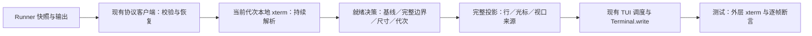

# Issue #222：Attach 首屏就绪设计（spec）

Drafted: callyouai/gpt-6.1-sol (selected) · callyouai/gpt-6.1-sol (physical) @ 2026-10-21T14:44:19.875Z
Revised: callyouai/gpt-6.1-sol (selected) · callyouai/gpt-6.1-sol (physical) @ 2026-10-22T14:56:20.840Z
Revised: callyouai/gpt-6.1-sol (selected) · callyouai/gpt-6.1-sol (physical) @ 2026-10-22T15:13:30Z
Revised: callyouai/gpt-6.1-sol (selected) · callyouai/gpt-6.1-sol (physical) @ 2026-10-22T15:57:13.939Z

- Issue：[zhuxixi/pi-agent-board#222](https://github.com/zhuxixi/pi-agent-board/issues/222)
- 状态：两轮异模型设计复核已收敛；第 2 轮无真缺口，父已吸收 1 项定时器细化，等待用户审批。尚未批准或实现；复核不等于实测通过。
- 调查／既有测量基线：`main@9a197f4bc2216e63cbda12f0cd9890ec9b3b6b34`。2026-10-22 回收复核时实际 HEAD 已为 `d41a16bbd3e55c6df1d1cdd60c43a7c2e2492482`；该范围只含 #221 的 events 源码／测试与设计文档，所引用 attach 文件无差异。旧测量仍只归属原基线；P1 必须重新记录实际检出、核对依赖变化，不把不同 commit 当同一性能样本。
- 实施计划：[issue-222-attach-ready-check.md](../plans/2026-10-23-issue-222-attach-ready.md)。本文定义行为、状态和验收契约；计划负责任务、修改文件与执行顺序。
- 落位例外：本轮 Plannotator 规划模式只允许在当前工作目录内写 Markdown，因此临时放在 `plans/`。不写 `~/.github-issue-driven/`、不改配置、不创建 worktree；规划解除并获准后按 issue-driven 归档到隔离 worktree 的 `docs/superpowers/specs/2026-10-21-issue-222-attach-ready-design.md`，调研／复核留痕迁至 issue 归档目录。不得把临时路径当作已完成归档。

## 1. 问题与目标

忙碌会话持续输出时，attach 等待约 2.5 秒才显示内容；快照本身约 5ms 已到。已确认的原因是每个输出解析回调重置 250ms 安静期，最后由 2500ms 硬上限结束 loading。旧逻辑负责遮挡日志回放和 resize-jiggle；现代协议仍复用了这段等待。

用户要求同时解决切入速度和过渡画面：第一个会话画面直接包含最新回复尾部及输入区域；活动提问／选择界面保持当前状态；之后不得露半帧、旧内容、错误尺寸、残影或双光标。用户主动向上滚动后不抢回底部。体验参照 Claude Code 会话恢复／子代理切换，不推测其实现。

既有单次记录为持续输出首屏 2512ms、安静首屏 268ms。这些数字只证明现状延迟；半帧泄露仍是假设，候选性能与成功率均未测量。

## 2. 调研依据与边界

已复用前轮代码与历史调查，并读取 issue #222 正文、PR #122 的实现说明和 CR：序号连续性、旧尺寸、协议降级、重启空基线和旧日志污染都已有兼容性契约。`finishCollecting()` 的快照校验与本地 `whenIdle()` 不能证明子 TUI（终端界面）已完成整帧；resize applied 也不证明重绘完成。

JFox 永久笔记中的 attach 输入分段、就地删除和安装路径材料用于确认输入／命令入口／部署边界，没有找到可直接证明本问题闪屏根因的笔记。最近查询结果和历史依据记入本轮调研留痕，不将历史安装版本当作当前加载版本。

本轮只设计；不运行新实验、不改源码或测试、不提交或发布。既有 `screen.log`、legacy settle／jiggle、底部投影、主题桥、恢复协议和 detach 契约均为本次设计的约束。

## 3. 范围与非目标

- 现代 snapshot+subscribe 路径改用有证据的画面就绪条件；正常忙碌会话不再等待全局安静期。
- 首屏和后续绘制共用画面完整性契约，避免控制消息绕过输出合并器。
- 同尺寸、尺寸变化、空基线、恢复和 legacy 分开定义、测量及验收。
- 不升级依赖、不修改协议版本、不增加 End 注入、不增大全屏清理次数；不夹带输入拦截或延迟显示 loading 的体验改动。
- 缺少可证明的完成信号时不猜测；以诊断证据为依据决定是否需要另审协议扩展。

## 4. 组件与数据流

### 4.1 职责与权威来源

`createTerminalAttachClient()` 继续拥有订阅、序号校验、补发、恢复和 generation（子进程代次）判断；`snapshotReady` 仅表示传输基线已校验，不直接触发显示。`PtyAttachComponent` 拥有本地解析、当前目标尺寸、视口意图和可发布投影；TUI 继续拥有调度、差分绘制和终端写入。测试观测器只观察实际输出，不能成为生产就绪逻辑的一部分。



### 4.2 本地状态与最小数据模型

以下为待新增的设计接口，名称不是现存 API。纯状态定义在 `src/core/pty-attach-render.mjs`；组件中的适配器读取现有事件并执行作用。保持现有 `createAttachOutputRenderScheduler()` 的 40ms 合并，不把每个 chunk 都变成全屏渲染。

| 状态数据 | 定义与失效条件 |
| --- | --- |
| `connectionToken` | 当前 socket 连接标识；旧 socket 消息不可改动当前状态。 |
| `baselineToken` | 每次权威基线替换递增；与 `generation`、parser 实例共同围住异步解析队列。 |
| `targetSize`／`geometryRevision` | 当前实际 body 列／行及尺寸修订号；真实 resize 或目标变化就使旧尺寸投影失效。 |
| `baselineState` | `unverified`／`hydrating`／`valid-empty`／`valid-content`；日志回放永远不能赋值为协议有效基线。 |
| `frameState` | `unknown`／`open`／`complete`；来自真实 xterm 同步更新模式与已验证的帧边界。 |
| `deadlineState` | `pending`／`expired`；组件适配器持有现有保护定时器，按本次连接／等待身份写入到期事件。纯决策只消费该输入，不读时钟、不启动 timer；到期仅改变等待原因／有界恢复动作，不能把未完成画面升级为 ready。旧身份到期回调和 dispose 后回调无效。 |
| `committedView` | 对有同步标记的现代路径无条件保留最小完整视图：当前可见完整投影行、光标、来源 token、尺寸修订号、视口意图及可见范围交互所需元数据；不得引用会继续变化的 xterm 行对象。 |
| `transitionFinished` | 只从 false 变 true；只管首次 attach 副作用，不被恢复重置。 |
| `closed` | dispose 后永久 true；所有回调、调度、探测与监听器都必须服从。 |

`decideAttachPresentation(state)` 是拟新增纯函数，返回 `wait`（附原因）／`publish`／`legacy`／`closed`，不读时钟、终端或文件。`canPublishAttachView(viewIdentity, currentIdentity)` 是拟新增来源比较纯函数，用于拒绝旧 token、尺寸、generation 或 parser 的投影。当前 `receivedOutput` 只表示缓冲区有内容，不再单独承担现代协议就绪语义。

### 4.3 解析隔离与基线替换

在新的权威基线进入时，组件替换本地 xterm 实例，保留构造参数、现有历史上限与投影规则；将 `term` 的 readonly 绑定改为受组件管理的当前 parser。新 parser 先安装同样的边界观察，再接收权威帧和有序补发；旧 parser 的回调即使后来完成也无法污染新 buffer，且必须同时通过 token 与实例身份检查才能发布。旧 parser 和 CSI 注册句柄被 dispose；不能只给回调加 token，却让旧 write 留在同一个活动解析队列中。

替换发生在 `snapshotReady`，因为此前序号校验尚未完成；`snapshotBegin` 只保存尺寸和当前 collecting 身份，不把未校验内容发布。新基线使历史 floor、selection 与缓存的来源同步更新；滚动意图按既有行为保留，只有内容身份确实变更或旧坐标不再有效时才清除，不因普通 live 输出回到底部。非空水合后继续使用 `historyFloorAfterHydrate()`；空基线 floor 为 0。

水合生成的 ANSI（控制终端的转义序列）本身含模式恢复和光标停车，不能把其中任何一次 CSI 关闭当作用户画面已经完成。`hydrating` 期间禁止边界发布；水合回调完成后才能读取恢复后的模式、光标和有效投影。`finishCollecting()` 随后同步 emit 的 catch-up flush 必须按原有顺序排队；每个完整边界上的投影需当时复制，不能等整个 chunk 回调时才读取已经进入下一帧的网格。

### 4.4 完整投影与交互

对有同步标记的现代路径，帧边界发布、最小 `committedView` 和 `render()` 投影选择入口的门控是无条件机制：首屏和后续绘制共用同一规则，status、ticker、鼠标和主题渲染都不能绕过。同步块打开期间只显示同来源、同尺寸的上一张完整视图；不存在时显示 loading。关闭边界通过 `parser.registerCsiHandler()` 观察并返回 `false`，保持默认解析；先验证 handler 时刻能读取的网格／光标状态，再取不可变投影。此机制不以 P2 是否重现用户现场闪屏为开关；P2 用于定位现场原因并验证机制接缝，不能用“本实验未复现”免除 A3。

帧尾之后的 Pi 光标停车通常在同步块外；这类光标／模式变化按现有 cursor coalescing 处理，只能更新完整网格对应的光标，不能解锁正在写入的新网格。测试分别检查硬件光标和字符属性形成的软光标。最小完整视图只在有效完整边界／可验证的完整投影变更时提交，继续使用现有 40ms 调度；不逐 chunk 复制历史、不反复序列化终端。超出可见范围的额外历史缓存或通用缓存框架不属默认方案，只有具体证据表明现有接缝不足时才另行修订。无同步标记和 legacy 的保证边界仍由 §5.3／A7 单独定义。

滚动、选择、复制和链接命中必须使用与当前呈现一致的行／坐标来源，不能显示缓存 A 却从解析中 B 复制。优先只缓存可见范围及现有命中测试所需的文本、属性和链接信息；不复制整个历史。同步更新期间用户触发超出缓存范围的滚动请求时，记录视口意图，在下一完整边界用既有 `project()` 应用，期间保持当前完整画面；新输出不得取消该意图。若实测所需的选择／命中信息无法局限在这个接缝内，诊断 gate 要求修订缓存设计，不能默默退化交互。

## 5. 状态、事件与就绪规则

### 5.1 正常现代协议路径

正常首次 publish 必须同时满足：模式为 protocol、当前非空权威基线已校验并解析、没有已知未完成同步更新、完整画面属于当前连接／基线／generation、目标尺寸有效且有该尺寸画面的完成证据、组件未关闭。水合后恢复模式为 closed 的同尺寸非空快照可以作为已提交屏幕；恢复为 open 的快照必须等其真正帧尾，不能把传输层 `snapshot_end` 当帧尾。

现代协议 publish 不调用 `deferAttachSettle()`；输出持续更新也不重置就绪。首次满足规则后通过现有 `finishAttachTransition()` 完成 timer cleanup、一次强制替换、健康探测、主题桥和颜色探测。已完成之后的普通更新只发布完整投影，不重开 loading，不重做首次副作用。

现有 connect 回调会在模式判定前 `startAttachSettle()`，因此仅删除输出中的 defer 不足以改变转换时序。确认 `mode=protocol` 时组件必须解除已武装的 250ms settle，并将现有 2500ms hard timeout 收编为 `deadlineState` 的到期输入；已经排队的旧 timer 回调仍须核对模式、等待身份与 closed。模式尚为 undecided 时两类 timer 均不得直接调用 `finishAttachTransition()`；现代路径只有合格 publish 决策能执行首次转换。若客户端选择 legacy，则恢复既有 settle／jiggle／hard-timeout 路径和期限，不重置原等待起点来额外增加等待，协议 probe 期限不变。这保留 #128 的“首次转换单点翻转、hooks 至多一次”约束，并防止 S／A4／A5／C 等待超过 250ms 时提前启动主题桥、清屏或健康探测。

| 事件／前置 | 画面状态与动作 | 验收 ID |
| --- | --- | --- |
| 初始 undecided | 保持 loading；日志／探针广播可按现有路径解析但不能成为 protocol 首屏。 | A2、A6 |
| `snapshotBegin` 同尺寸 | 保存 collecting 身份，不发 resize、不发布。 | A1、A4 |
| `snapshotBegin` 不同尺寸 | 记录目标修订号，只发一次真实目标尺寸；遮住旧尺寸内容。 | A4 |
| 校验失败／`resubscribing` | 延用客户端既有有界恢复；本地基线标无效，不发布未校验内容。 | A2、A6 |
| 非空 `snapshotReady` | 替换 parser，进入 hydrating，权威帧后接原顺序补发；解析完成再判完整模式与尺寸。 | A1–A3、A6 |
| 空 `snapshotReady` | 替换 parser、清 floor 与旧内容，状态 valid-empty；等待本代 child 的有效完整编辑画面。 | A5、A6 |
| 同步块开启／关闭 | 开启只解析；关闭且满足 gate 才复制投影并请求绘制。同 chunk 关开必须保住关帧瞬间。 | A3、A8 |
| 同 generation 断连 | 可保留同尺寸完整画面并显示重连状态；停止新连接身份未确认的发布。 | A6 |
| 同 generation 连续重放恢复 | 保留 parser 与连续缓存；依客户端连续性事件恢复发布，不要求必有新快照。 | A6 |
| epoch 更换／新的空基线 | 立即使旧画面失效；只允许新 generation 的权威基线或完整 live 画面。 | A5、A6 |
| protocol→legacy fallback | 关闭现代发布门控，保留既有 legacy settle／jiggle／heal，不借现代就绪事件提前放行。 | A7 |
| dispose／detach | 撤销 listener、定时器、CSI handler、parser 与缓存；延迟回调零发布；detach 行为沿用现有协议。 | A9 |

### 5.2 尺寸变化和冷启动的诊断 gate

当前协议没有“本次 resize 的 child 全面重绘已完成”的权威事件，`applied`、下一输出 chunk、任意一次同步块关闭都不足以替代。因此 A4 是**实施前诊断 gate**：批准后先用可控 child 和真实 TUI 记录时序，确认能否仅用现有生产信号归属当前目标尺寸的完整重绘；fixture 的帧号／INPUT 标记只能作为独立测试真值，不能混进生产判定。

A5 同样要求区分 boot 文本、raw-mode 信号和完整编辑画面。当前 `childInputReady` 只用于颜色报告安全，不单独证明首屏就绪；生产不能硬编码搜索 `INPUT` 或中文界面文本。诊断阶段必须验证真实 Pi 完整渲染边界与其启动序列能否形成充分条件。

诊断结果必须是可审查的事件条件和反例测试。如果 A4/A5 缺少充分条件，则**不进入生产修复 P4**：记录无法区分的最小两条事件轨迹，给出所需最小信号并修订本 spec 后重新复核／审阅。不能仅优化同尺寸路径后声称 #222 全部解决，也不能为这些场景添加新的固定等待。

### 5.3 超时和兼容输出

2500ms 在现代协议中只是诊断／恢复保护线，不能强制 publish 已知半帧、空基线或错误尺寸。到期保留可 detach 的等待画面，记录等待原因；只复用现有客户端恢复预算，不添加无界重订阅或反复重置 2500ms 的死循环。协议错误最终按既有预算进入 legacy；纯粹没有完整帧的场景不能谎报成功，记试验失败。

无同步标记的输出走既有保守策略，单列为兼容场景，不宣称具备现代整帧保证。legacy 的 250ms／2500ms 与 jiggle 行为保持，既有 `AGENT_BOARD_TERMINAL_SNAPSHOT=0` 仍是显式回滚开关。probe 超时等兼容性期限不因本 issue 改变。

## 6. 可测性拆分

以下模块接口是拟新增设计，不作为当前仓库能力对外陈述；函数的最终导出名可在不改变边界和验收 ID 的前提下调整，并更新计划。

| 接缝／位置 | 独立输入与输出 | 最低足够测试层级／覆盖边界 | 验收 ID |
| --- | --- | --- | --- |
| `decideAttachPresentation()`，现有 render helper | 含 `deadlineState` 的纯状态 → wait 原因／publish／legacy／closed；无 timer、I/O | unit：枚举门禁组合、空基线、尺寸 unknown、保护线 pending／expired、过期身份到期无效且超时不可强制就绪 | A1、A4、A5、A7、A9 |
| `canPublishAttachView()`，同 helper | 投影身份与当前身份 → boolean | unit：旧连接、基线、parser、尺寸、generation、closed 均拒绝 | A2、A6、A9 |
| `observeAttachFrameBoundary()`，组件薄适配（待新增） | xterm 公开 CSI hook／模式，输出 immutable 完整边界；返回 dispose | component：真 xterm、分片 CSI、同 chunk 关开、水合屏蔽、帧尾光标；禁止并行 ANSI 正则解析器 | A3、A8、A9 |
| `commitAttachView()`，组件内部方法（待新增） | 通过 gate 的真实 parser 投影 → 当前可见缓存与 requestRender | integration：实际 TUI 输出、所有渲染入口、滚动与命中测试；不把调用次数当屏幕正确 | A1–A3、A8 |
| 现有 `handleAttachEvent()`／`pushOutput()`／`finishAttachTransition()` | 协议事件 → parser 隔离、一次副作用、恢复和主题 I/O | integration：真实客户端与 runner；独立 fixture 事件提供时序真值 | A2、A4–A7、A9 |
| `attach-presentation-fixture.ts`（待新增） | 原样 Terminal.write → 外层 xterm 中逐帧网格／光标／时间 | unit＋component：先注入单帧旧内容、空屏、上下半屏错号、第二光标，确认全能检出；块外写也可见 | A10 |
| 重复实验统计 helper（scenario 测量文件内，待新增） | JSON 试验记录 → 分位数／成功率／Wilson 区间／失败清单 | unit：已知样本、超时 `+∞`、基础设施失败单列、固定分位数算法；opt-in E2E 测真实性能 | A10、A11 |

新增 `test/attach-ready-report.test.mjs` 对统计纯函数进行已知输入断言；普通 `npm test` 只跑确定性用例。重复 100／30 次实验显式开启，不加入每次 CI。真实时间试验与 fake clock 回归分开，父进程统一单调时钟标记；跨进程只比较父侧收到事件的时刻，并报告测量边界。

## 7. 验收矩阵

自动化证明门禁、事件顺序和写给终端的画面；用户实测核对当前终端中的实际呈现。每项都必须有计划任务及实际证据，自动化通过不能关闭实测 pending。

本矩阵的 A1–A12／U1–U3 仅限 issue #222 命名空间；报告、检查记录与 issue 评论使用 `#222-A11` 等全称。仓库 README／VERIFY.md 中 #121／#91 的裸 A11 是 `npm run test:perf` 的既有三项 perf-gate，不是本设计的 1660 次重复试验；两者分别留证，不能互相替代。

| ID | 功能点／决策 | 验收方式 | 命令／操作与通过标准 | 计划任务 |
| --- | --- | --- | --- | --- |
| A1 | 同尺寸完整基线立即发布，忙碌／安静均不等 settle | 自动化（unit＋integration） | `node --test test/pty-attach-render.test.mjs test/pty-attach-ready.test.mjs`；完整条件已成立时未到 250ms 即正确首屏，零 resize／jiggle；完整帧被推迟到 >250ms 且 <2500ms 时不得提前转换 | P3、P4 |
| A2 | 权威来源、校验失败、catch-up 和水合不露中间状态 | 自动化（integration） | 上述 ready 测试＋`node --test test/pty-attach-protocol-e2e.test.mjs test/terminal-snapshot.integration.test.mjs`；毒日志、未校验帧、旧队列均不发布，原序号恢复不退化 | P2–P4 |
| A3 | 同步块内所有绘制入口都看完整画面 | 自动化（component＋integration） | ready 测试；分片、同 chunk 关开、status/ticker/主题各触发绘制；完整目标前零半帧，后续也无错误帧 | P2–P4 |
| A4 | 目标尺寸的完成证据、零／一次真实 resize | 自动化（integration；实施前 gate） | ready＋protocol 测试，G1–G3；旧尺寸帧与 ack 不可发布；先证明确切生产条件或停止 P4 修订设计 | P2–P4 |
| A5 | 空基线／冷启动不会显示旧屏、boot 或半个编辑器 | 自动化（integration；实施前 gate） | ready 测试，C；boot、raw-mode、完整 live 帧分阶段；仅充分条件成立后发布，否则停止 P4 | P2–P4 |
| A6 | reconnect、epoch reset、resnapshot 来源正确 | 自动化（integration） | ready＋protocol 测试驱动既有 restart fixture，R 两子格；无新快照续播可恢复，新代次不回流旧画面 | P3、P4 |
| A7 | unframed／legacy fallback、保护期限与异常等待 | 自动化（unit＋integration） | ready 测试＋`node --test test/pty-attach-desync-health-e2e.test.mjs test/pty-attach-desync-heal.test.mjs`；legacy settle/jiggle 保留，现代超时不露已知坏屏，detach 可用 | P3、P4 |
| A8 | 底部、活动界面、长历史、宽字符与光标；上滚及复制命中一致 | 自动化（component＋integration） | ready 测试，L 与附加交互用例；首屏 TAIL＋INPUT 或当前选择界面，滚动意图保留，复制／链接与可见内容一致 | P3、P4 |
| A9 | 一次就绪副作用、颜色延迟、dispose 清理 | 自动化（unit＋integration） | ready 测试＋`node --test test/pty-attach-scheme-readiness.test.mjs test/pty-attach-settle-scheme.test.mjs test/pty-attach-startup-color.test.mjs`；D/T 与旧回调零发布；延迟完整帧前 hooks 为 0、首次合格 publish 后为 1，迟到 timer 不再触发；现有 pending scheme 语义保留 | P3、P4 |
| A10 | 观察器和统计本身能检错、失败留痕完整 | 自动化（unit＋static） | ready 测试含观察器自测＋`node --test test/attach-ready-report.test.mjs`；人为错误帧不能被最终正确帧抹掉，超时不从分布消失 | P2、P3、P5 |
| A11 | 延迟与成功率达到分场景目标 | 自动化（opt-in E2E） | 计划中的真实入口重复 CLI；B/Q/L 总延迟 P95≤200ms、最大≤500ms，S/C/R 完整画面后 P95≤100ms、最大≤200ms；G 总延迟 P95≤500ms、最大≤1000ms，完整目标帧后 P95≤100ms；每格零产品画面错误 | P5 |
| A12 | 类型、性能、全仓回归、coverage、打包 | 自动化（static＋build＋unit／integration） | `npm run verify` 全通过；不得只用 `npm test` 替代 | P6 |
| U1 | 实际终端切入当前工作区、无可见闪烁／残影／双光标 | 用户实测 | 候选明确加载后，隔离会话 fullscreen B/Q/L 各10次、regular B/Q各5次，录屏逐帧核对；每次首屏正确、过程无错误画面 | P6 |
| U2 | 实际终端尺寸变化、冷启动、重连／重启 | 用户实测 | 同候选环境，各5次隔离试验；首屏尺寸与来源正确，无历史位置再跳底、无旧代次回流；冷启动耗时单列 | P6 |
| U3 | 交互及退出仍正常 | 用户实测 | U1/U2 每类至少1次继续输入、主动上滚后让 child 输出、选择复制已知文本、detach／再 attach；输出不抢回、复制一致、退出正常 | P6 |

A11 的具体子格、样本量和统一统计口径在计划 Verification 中固定：B/Q/S 与 L 两子格各100次，G1–G3/C/R两子格/T两子格/U两子格/D各30次，两版共1660次正式试验。每格5次预热排除且单列，候选／基线交错，首屏后观察至少3秒。P50/P95 为排序后第 `ceil(p×n)` 项；产品超时按 `+∞`；所有失败保留、95% Wilson 区间不外推未测环境。每次上限10秒，基础设施失败超过5%整格无效。

## 8. 部署、回滚与保证边界

U1–U3 在代码实现、自动化完成、候选可加载后执行；不以录屏替代精确自动化时序，也不把外层 xterm 当作真实终端像素证据。终端渲染／图形合成与输入法行为不适合由进程内模拟完全证明，所以保留实测；60fps 录屏无法排除更短的像素变化，报告须写明这一限制。

实际检查使用独立 Pi 测试会话、临时 agent root 和明确的本地扩展入口，不修改全局设置、不对活跃用户会话发测试输入或 kill。启动前后记录父 Pi、child Pi、TUI、xterm 的实际加载路径／版本、终端名／版本及尺寸；现有仓库 Pi TUI 1.1.0 与宿主安装目录 1.3.0 必须分清，目录名不是解析证明。

候选加载前只读检查 `~/.pi/agent/extensions/agent-board` 的存在与真实指向，并核对候选入口的 realpath／commit／文件哈希。U 项固定使用隔离进程的一次性显式入口，不执行 `pi install`、不改全局 symlink：待实现获准后，以临时 `PI_CODING_AGENT_DIR`、`--no-extensions` 关闭自动发现，再用 `--extension` 指向候选 worktree 的绝对 `index.ts`；显式入口在关闭自动发现后仍会加载。以下只是已从宿主 Pi 的 `docs/cli.md`、`docs/packages.md` 与 `docs/environment-variables.md` 核实的拟执行命令，当前不启动新 Pi：

```bash
PI_CODING_AGENT_DIR="$ATTACH_222_AGENT_DIR" pi --no-extensions --no-mcp --extension "$ATTACH_222_CANDIDATE_ENTRY" --tui-mode fullscreen --verbose
```

`ATTACH_222_AGENT_DIR` 是获准后准备的临时配置目录，不复用真实会话；`ATTACH_222_CANDIDATE_ENTRY` 是经 realpath 核对的候选 `index.ts` 绝对路径。regular 验收只改变 `--tui-mode`。执行前核对实际 Pi 版本对应的 CLI 支持和安全认证前置；不复制／回显凭据，不因配置缺失改用全局安装。全新试验进程启动后，再从实际资源加载记录与模块解析证据核对入口和依赖；`--verbose` 或启动命令本身不是证明。不能证明运行的是候选、发生双重加载或无法在隔离环境启动时，U 项保持 pending。

发布与全局安装不在本轮授权内；临时 `AGENT_BOARD_TERMINAL_SNAPSHOT=0` 仅在隔离进程验证 legacy，不持久更改配置。正式回退可按既有 PR／版本流程撤销改动；该开关只恢复 legacy 路径，不等于新的完整帧保证。

A4/A5 没有充分生产信号、完整投影需要越界改协议、解析 API 不可用、重复实验出现未归因错误，均停止生产修复并留证修订。单次 guard 失败不以增加等待掩盖；同架构连续三次针对性假设失败转架构复盘。人工验收环境不可用时 U 项保持 pending，不能宣称“快且不闪”全部验收。

## 9. 流程交接

当前处于 issue-driven 步 4（设计／根因报告），不能把先前实施计划替代设计 gate。设计完成后按 `spec-cross-review` 异模型复核，默认最多 4 轮，每轮只读 fresh-context reviewer，由主会话统一修订和写留痕；然后在 Plannotator 提交同一计划及本 spec。

实际授权归档不存在，默认 `stepwise`。当前用户明确要求使用 issue-driven 并补 spec，覆盖设计与该流程要求的只读复核；不升格为自动 push／PR／合并授权。认领／issue 评论、仓外归档、worktree、代码实现和提交等后续动作受当前规划限制及既有授权约束，未执行的步骤明确标为 pending。

## 10. 交叉复核状态

2026-10-22：第 1 轮从运行产物收回完整 structuredOutput，提出 1 个真缺口和 4 项细化，父逐条裁定并修订。第 2 轮重新核对五视角与真实代码，确认前轮修订有效，返回 0 个真缺口、1 项细化、6 项核对通过。原报告把 passes 误写为 5，父保存原始版后只请求计数勘误；已核验 findings／lenses／被审版本均未变化，未重跑审查、未新增轮次。

两轮 child 实际模型均为 `zai-coding-cn/glm-5.3`，主会话最近 assistant physical 为 `callyouai/gpt-6.1-sol`，异构审计通过。父按第 2 轮建议吸收 R2-D1：明确初始 settle 和 hard timer 的模式门控／处置，并补 A1／A9 的延迟完整帧时序断言。按技能规则，零真缺口且细化吸收后进入设计待确认，不启动第三轮；此最终小修订不是又一轮独立复核结果。

哈希、运行 ID、原始回报、计数勘误和逐条裁定统一记在 [spec-cross-review-state.md](/home/elling/.github-issue-driven/zhuxixi/pi-agent-board/issue-222/research/spec-cross-review-state.md)、[第 1 轮报告](/home/elling/.github-issue-driven/zhuxixi/pi-agent-board/issue-222/research/spec-review-round-1.md) 与 [第 2 轮报告](/home/elling/.github-issue-driven/zhuxixi/pi-agent-board/issue-222/research/spec-review-round-2.md)，不把本文件的被审哈希写回本文件。设计复核已收敛，但审批 gate 仍关闭；必须经用户确认并解除规划限制后，才可进入 worktree、实施或 Step 6 正式计划。


## Execution Handoff — 2026-10-23

Design approved by the user at 2026-10-23T08:20:19+08:00. Planning restrictions are explicitly ended for this approved execution. This is the approved design with only link relocation and this handoff note; archived spec SHA-256 remains `10c0a158ff4ac222d0c11a394f14b275292e96ee44b047cf17f1be45f949a64e`. Diagnostic #222-A4/A5 and manual U1–U3 gates remain binding. No commit/push/publication authorization is implied.
